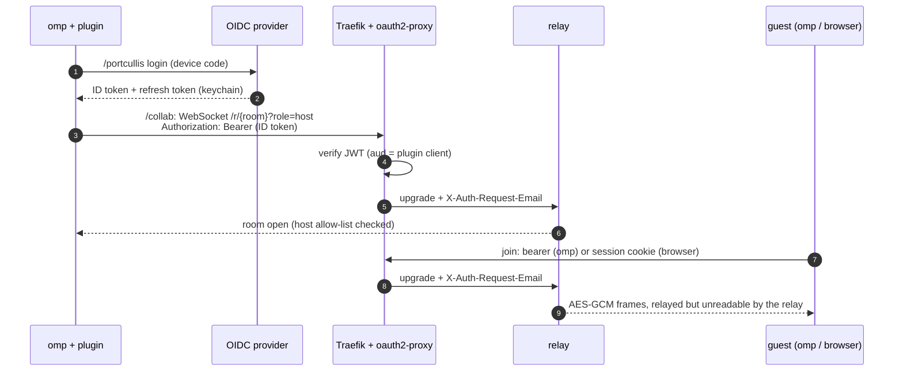

<div align="center">

# portcullis

**Self-hosted [omp](https://github.com/can1357/oh-my-pi) collab, behind your own SSO.**

Share a live omp session through a relay you run, and let in only people your OIDC provider admits.

[](https://github.com/FYWinds/portcullis/actions/workflows/ci.yaml)
[](LICENSE)
[](https://github.com/can1357/oh-my-pi)

[Deploy guide](deploy/README.md) · [How it works](#how-it-works) · [Plugin](#plugin) · [Development](#development)

</div>

---

omp's `/collab` streams your session to other terminals and browsers through a relay. By default that relay is the public `wss://my.omp.sh`, and anyone holding the link gets in. The production relay isn't published, so you can't self-host it as is.

portcullis gives you both halves to run it yourself:

| | |
|---|---|
| **Relay** (`relay/`) | The omp collab relay protocol plus the collab-web browser client. It is built to sit behind Traefik and oauth2-proxy: it trusts the identity the proxy forwards, refuses anything without one, and lets only listed users open rooms. |
| **omp plugin** (`plugin/`) | Logs in to your OIDC provider with the device-code flow, keeps the token in the OS keychain, and adds `Authorization: Bearer <id token>` to omp's collab connections. That way `/collab` and `omp join` pass the same gate browsers do. |

## Features

- **Two locks instead of one.** Rooms stay end-to-end encrypted by omp, with the key only in the link, and an OIDC login decides who may connect at all. A leaked link on its own gets nobody in.
- **Every client works.** `/collab` hosts, `omp join` and `/join` guests, and browser guests via the bundled web client, which sends people through your SSO and back into the session.
- **Hosting is narrower than joining.** An allow-list limits who may open rooms; anyone your provider admits can join with a link.
- **The room key never leaves the browser**, not even during the login redirect.
- **Tokens stay scoped.** The plugin signs connections only to the relays you list, never to `my.omp.sh`.
- **Ready-made deployments:** [Docker Compose](deploy/docker-compose/) with Traefik and Let's Encrypt, and [Kubernetes](deploy/kubernetes/) manifests plus oauth2-proxy Helm values. A local stack with a mock identity provider lets you try it in a minute.

## How it works



- **The gate is oauth2-proxy**, mounted as Traefik forwardAuth. It accepts the plugin's ID token as a bearer (`skip-jwt-bearer-tokens` + `extra-jwt-issuers`) and the browser's session cookie, and forwards the identity in `X-Auth-Request-Email`.
- **The relay** routes sealed frames between one host and its guests. It sees room ids, sizes and identities, never keys or content. It speaks the same protocol as omp's relay, ported from upstream's [`local-relay.ts`](https://github.com/can1357/oh-my-pi/blob/main/packages/collab-web/scripts/local-relay.ts).
- **Browser guests** load the public client, which first checks `/auth/check`. If they aren't signed in, it stores the room link in `sessionStorage`, sends them through the login, and restores the link on return.

## Quick start

1. **Deploy the relay** by following the [deploy guide](deploy/README.md) (Compose or Kubernetes, about 15 minutes with an existing OIDC provider). To just try it, the [local stack](deploy/README.md#try-it-locally) runs everything on `localhost` with a mock provider.
2. **Install the plugin** on every machine that hosts or joins:
   ```bash
   omp plugin install https://github.com/FYWinds/portcullis
   ```
3. **Configure it** in `~/.config/portcullis/config.json`:
   ```json
   {
     "issuer": "https://auth.example.com",
     "clientId": "<plugin client id>",
     "hosts": ["collab.example.com"]
   }
   ```
   then point omp at your relay:
   ```bash
   omp config set collab.relayUrl wss://collab.example.com
   ```
4. **In omp**: `/portcullis login`, approve the code in your browser, then `/collab`.

## Plugin

### Commands

| Command | Effect |
|---|---|
| `/portcullis login` | Device-code login: prints the verification link and code, and opens the browser (`PORTCULLIS_NO_BROWSER=1` only prints) |
| `/portcullis status` | Identity, token expiry, signed hosts, token store, last refresh error |
| `/portcullis logout` | Deletes the stored tokens |
| `Ctrl+Alt+P` | Same as `/portcullis status` |

### Configuration

`~/.config/portcullis/config.json` (override the path with `PORTCULLIS_CONFIG`):

| Key | Default | Meaning |
|---|---|---|
| `issuer` | required | OIDC issuer. `https://` only (`http://` allowed for localhost) |
| `clientId` | required | Public client with the device-code and refresh-token grants |
| `hosts` | required | Relay hosts that get the token, as `hostname` or `hostname:port`. Every other WebSocket is left untouched |
| `scopes` | `openid profile email offline_access` | `offline_access` gives a refresh token |
| `tokenFile` | unset | Store tokens in this file (mode 0600) instead of the OS keychain |
| `statusLine` | `true` | Show the signed-in identity (or "signed out") in omp's status line; `/portcullis status` works either way |

### Behaviour

- **Tokens** go in the OS keychain through `Bun.secrets` (service `portcullis`), unless `tokenFile` is set.
- **Refresh** happens in the background once less than 5 minutes are left. If the provider rejects the refresh token, the plugin signs out; other failures keep the tokens and retry.
- **Signed out**, connections to your relay go out unsigned and the proxy refuses them. A host retries and recovers after `/portcullis login`; a guest join fails at once.
- **Log in before `/join`.** omp blocks extension commands for guests inside a session.
- **Install, don't `-e`.** `omp join <link>` re-parses its own arguments and drops `-e`, so use an installed plugin.

### How the hook works

omp has no extension hook for the collab connection. Its relay client (`packages/coding-agent/src/collab/relay-client.ts`) opens the socket through the global `WebSocket`, and Bun's constructor accepts a `headers` option. The plugin replaces `globalThis.WebSocket` with a subclass that adds the header for configured hosts only.

It also registers the `Ctrl+Alt+P` shortcut, which makes omp load it before the session starts. Extensions that register nothing a first frame needs are loaded after the composer appears, too late for `omp join`, which connects right away and doesn't retry.

**If a future omp breaks either assumption, it fails closed:** connections go out unsigned and the proxy refuses them. Nothing gets in that shouldn't.

## Repository layout

```text
plugin/            omp extension (the repo root package.json is the plugin manifest)
relay/             relay server + Dockerfile (bundles collab-web from the pinned omp release)
deploy/            deploy guide, docker-compose/ and kubernetes/ examples
dev/               mock OIDC issuer and a no-Docker local stack (dev/stack.sh)
```

## Development

```bash
mise install          # bun 1.4.4 (or install bun yourself)
bun install
bun run check         # typecheck + tests
```

`dev/stack.sh` runs the mock issuer, the relay and oauth2-proxy without Docker (bring your own `oauth2-proxy` binary). [`deploy/docker-compose/compose.local.yaml`](deploy/docker-compose/compose.local.yaml) does the same with Traefik in Docker. Both are how a new omp release gets checked end to end.

### Upgrading omp

1. Bump `@oh-my-pi/pi-coding-agent` (types only) in `package.json` and `OMP_REF` / `OMP_SHA` in `relay/Dockerfile`. Get the commit of a tag with `git ls-remote https://github.com/can1357/oh-my-pi refs/tags/vX.Y.Z`.
2. Check that the plugin's assumptions still hold:
   - `relay-client.ts` constructs its socket through the global `WebSocket`;
   - shortcuts still force an eager extension load (`canBindAfterStartup` in `extensibility/extensions/startup-deferral.ts`).
3. Run `bun run check`, then the local stack: login, `/collab`, `omp join`, and a browser join.

## Limitations

- **One relay process.** Rooms live in memory: no horizontal scaling, and a restart drops rooms (hosts reconnect on their own).
- **The hook depends on omp internals** (see [How the hook works](#how-the-hook-works)). A supported way to add headers to the collab socket would make it unnecessary.
- **Collab only.** omp's `/share` (static encrypted snapshots) is not covered.

## Credits

The relay protocol and the bundled browser client come from [oh-my-pi](https://github.com/can1357/oh-my-pi) (MIT, © Mario Zechner, Can Bölük, Stencil Labs). portcullis is not affiliated with the omp project.

## License

[MIT](LICENSE)
