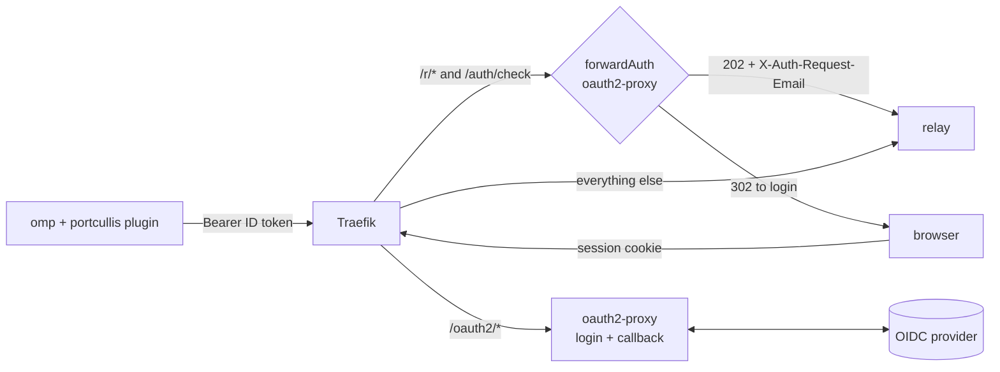

# Deploying portcullis

This guide puts the relay on your own host behind an OIDC login and points omp at it. Two ready-made setups:

| Setup | Folder | What it runs |
|---|---|---|
| Docker Compose | [`docker-compose/`](docker-compose/) | Traefik with Let's Encrypt, oauth2-proxy, the relay. One host, one domain |
| Kubernetes | [`kubernetes/`](kubernetes/) | Relay manifests and Traefik `IngressRoute` (kustomize), plus Helm values for oauth2-proxy |

Both use the same layout on a single hostname:



- **`/r/*`** (WebSocket rooms) and **`/auth/check`** pass through oauth2-proxy. It accepts either the plugin's ID token as a bearer or the browser's session cookie, and hands the identity to the relay in `X-Auth-Request-Email`.
- **`/oauth2/*`** is oauth2-proxy's own login and callback.
- **Everything else** is the static browser client, public like `my.omp.sh`'s. It contains no secrets.

## Contents

- [1. Requirements](#1-requirements)
- [2. Register two OIDC clients](#2-register-two-oidc-clients)
- [3a. Docker Compose](#3a-docker-compose)
- [3b. Kubernetes](#3b-kubernetes)
- [4. Point omp at the relay](#4-point-omp-at-the-relay)
- [5. Verify](#5-verify)
- [Relay reference](#relay-reference)
- [Security notes](#security-notes)
- [Try it locally](#try-it-locally)
- [Troubleshooting](#troubleshooting)
- [Upgrading](#upgrading)

## 1. Requirements

- **An OIDC provider that supports the device authorization grant** (RFC 8628), for the plugin's login. Zitadel, Keycloak, Authentik, Okta and Auth0 all do. Tested: Zitadel v4.
- **A hostname with TLS**, e.g. `collab.example.com`. omp only allows `ws://` for localhost.
- **Docker with Compose**, or **Kubernetes with Traefik v3** (other ingress controllers work if they support forward auth and WebSockets; see [3b](#other-ingress-controllers)).
- **omp** (tested with v18.16.0; see [Upgrading omp](../README.md#upgrading-omp) for what the plugin depends on).

## 2. Register two OIDC clients

| | Browser login (oauth2-proxy) | omp plugin |
|---|---|---|
| Type | Web application | Native / public |
| Grants | Authorization code (+ PKCE), refresh token | **Device code**, refresh token |
| Client auth | Secret, or none with PKCE | None |
| Redirect URI | `https://collab.example.com/oauth2/callback` | none |
| Scopes | `openid email profile` | `openid profile email offline_access` |
| ID token | | Must carry the `email` claim (or key the relay on `sub`, see `PORTCULLIS_IDENTITY_HEADER`) |

oauth2-proxy accepts the plugin's ID tokens because their `aud` is the plugin's client ID and you list that ID in `extra-jwt-issuers`. If one client can do both flows on your provider, you can use it for both.

<details>
<summary><b>Zitadel</b> (tested)</summary>

Console → your project → **New application**:

- **Plugin**: type *Native*, authentication method *None*, grant types **Device Code** and **Refresh Token**. Under *Token settings* enable **User Info inside ID Token**, otherwise the ID token has no `email`.
- **oauth2-proxy**: type *Web*, authentication method *PKCE*, redirect URI as above, grant types Authorization Code and Refresh Token.

If the project has *Check authorization on authentication* enabled, both clients enforce the same role check. Use that to decide who can log in.

The same plugin client through the Management API:

```bash
curl -sS -X POST "https://auth.example.com/management/v1/projects/$PROJECT_ID/apps/oidc" \
  -H "Authorization: Bearer $PAT" -H "x-zitadel-orgid: $ORG_ID" -H 'Content-Type: application/json' \
  -d '{"name":"portcullis","appType":"OIDC_APP_TYPE_NATIVE","authMethodType":"OIDC_AUTH_METHOD_TYPE_NONE",
       "responseTypes":["OIDC_RESPONSE_TYPE_CODE"],
       "grantTypes":["OIDC_GRANT_TYPE_DEVICE_CODE","OIDC_GRANT_TYPE_REFRESH_TOKEN"],
       "accessTokenType":"OIDC_TOKEN_TYPE_BEARER","idTokenUserinfoAssertion":true}'
# → {"appId":"…","clientId":"…"}
```

</details>

<details>
<summary><b>Keycloak</b> (untested)</summary>

- **Plugin**: client authentication *off*, enable **OAuth 2.0 Device Authorization Grant**, standard flow off. The `email` scope must be a default scope.
- **oauth2-proxy**: client authentication on, standard flow on, valid redirect URI as above.

</details>

Check that your issuer advertises the device endpoint:

```bash
curl -s https://auth.example.com/.well-known/openid-configuration | jq -r .device_authorization_endpoint
# expect a URL, not null
```

## 3a. Docker Compose

```bash
cd deploy/docker-compose
cp .env.example .env
$EDITOR .env                    # hostname, issuer, both client IDs, cookie secret, HOST_ALLOW
docker compose up -d --build    # builds the relay from this checkout
```

| `.env` key | Value |
|---|---|
| `PORTCULLIS_HOST`, `PUBLIC_URL` | `collab.example.com`, `https://collab.example.com` |
| `ACME_EMAIL` | Let's Encrypt account e-mail (HTTP-01 challenge on port 80) |
| `OIDC_ISSUER_URL` | Issuer, no trailing slash |
| `OAUTH2_PROXY_CLIENT_ID` / `_SECRET` | The browser login client. A public PKCE client still needs a placeholder secret |
| `OAUTH2_PROXY_COOKIE_SECRET` | `openssl rand -base64 32 \| tr -- '+/' '-_'` |
| `PLUGIN_CLIENT_ID` | The plugin client |
| `HOST_ALLOW` | Comma-separated e-mails allowed to open rooms. Empty: any signed-in user |

DNS for the hostname must point at the Docker host, with ports 80 and 443 reachable. To use a published image instead of building, replace the relay's `build:` block with `image: ghcr.io/fywinds/portcullis:<version>`.

## 3b. Kubernetes

The manifests assume Traefik v3 (CRDs `traefik.io/v1alpha1`) and put oauth2-proxy and the relay in namespace `portcullis`.

1. **Edit the placeholders**: `collab.example.com` in `ingressroute.yaml`, `relay.yaml` and `oauth2-proxy-values.yaml`; `auth.example.com` and `<plugin client id>` in `oauth2-proxy-values.yaml`; `PORTCULLIS_HOST_ALLOW` in `relay.yaml`; the image tag in `kustomization.yaml`. Add `tls:` to the `IngressRoute` the way your cluster issues certificates.
2. **Create the namespace and oauth2-proxy's secret**:
   ```bash
   kubectl apply -f deploy/kubernetes/namespace.yaml
   kubectl -n portcullis create secret generic oauth2-proxy \
     --from-literal=client-id=<browser client id> \
     --from-literal=client-secret=<secret or placeholder> \
     --from-literal=cookie-secret="$(openssl rand -base64 32 | tr -- '+/' '-_')"
   ```
3. **Install oauth2-proxy** with the provided values:
   ```bash
   helm repo add oauth2-proxy https://oauth2-proxy.github.io/manifests
   helm install oauth2-proxy oauth2-proxy/oauth2-proxy -n portcullis -f deploy/kubernetes/oauth2-proxy-values.yaml
   ```
   Set `trusted-proxy-ip` to your pod CIDR. If your cluster already runs oauth2-proxy for other apps, add `skip-jwt-bearer-tokens` and `extra-jwt-issuers` there instead, and point the `Middleware` at it. Bearers that are not a valid JWT for a listed issuer (for example an app's own API key) fall through to the normal cookie check, so existing routes keep working.
4. **Deploy the relay**: `kubectl apply -k deploy/kubernetes`
5. **Check**: `kubectl -n portcullis get pods` shows `relay` and `oauth2-proxy` Ready.

Keep one replica: rooms live in memory, and a second pod would split them. The `NetworkPolicy` admits only pods labelled `app.kubernetes.io/name: traefik`; adjust it to your ingress controller.

### Other ingress controllers

Any reverse proxy works if it can:

1. send `/r/*` and `/auth/check` through forward auth to oauth2-proxy (`upstream: static://202`) and copy `X-Auth-Request-Email` from the auth response,
2. **strip client-sent `X-Auth-Request-Email`** on every route to the relay,
3. proxy WebSockets with idle timeouts above omp's 15-second ping,
4. route `/oauth2/*` to oauth2-proxy and everything else to the relay.

## 4. Point omp at the relay

On every machine that hosts or joins:

```bash
omp plugin install https://github.com/FYWinds/portcullis
mkdir -p ~/.config/portcullis
cat > ~/.config/portcullis/config.json <<'EOF'
{
  "issuer": "https://auth.example.com",
  "clientId": "<plugin client id>",
  "hosts": ["collab.example.com"]
}
EOF
omp config set collab.relayUrl wss://collab.example.com
```

Then in omp: `/portcullis login`, approve the code in the browser, and `/collab`. The printed links point at your relay. The browser link (`https://collab.example.com/#…`) asks guests to sign in first.

## 5. Verify

```bash
H=https://collab.example.com
curl -s -o /dev/null -w '%{http_code}\n' $H/healthz                                   # 200
curl -s -o /dev/null -w '%{http_code}\n' $H/auth/check                                # 302 (login)
curl -s -o /dev/null -w '%{http_code}\n' -H 'X-Auth-Request-Email: you@example.com' \
  "$H/r/aaaaaaaaaaaa?role=host"                                                       # 302: forged header ignored
curl -s $H/ | grep -c 'auth/check'                                                    # 1: bootstrap injected
```

After `/portcullis login`, the relay log (`docker compose logs relay` / `kubectl -n portcullis logs deploy/relay`) shows:

```json
{"event":"room_open","identity":"you@example.com","room":"Ab3xY9","rooms":1}
{"event":"guest_join","identity":"friend@example.com","room":"Ab3xY9","peer":1,"guests":1}
```

## Relay reference

| Env | Default | Meaning |
|---|---|---|
| `PORT` / `HOST` | `7466` / `0.0.0.0` | Listen address |
| `PORTCULLIS_IDENTITY_HEADER` | `X-Auth-Request-Email` | Header the auth proxy sets. Without it: 401. `none` disables the check (local development only) |
| `PORTCULLIS_HOST_ALLOW` | unset | Comma-separated identities allowed to open rooms; others get 403. Unset: any identity |
| `PORTCULLIS_MAX_ROOMS` | `32` | New rooms past this get 503 |
| `PORTCULLIS_MAX_GUESTS` | `16` | Guests per room; past this, close code 4029 |
| `PORTCULLIS_MAX_PAYLOAD_BYTES` | `16777216` | WebSocket frame limit |
| `PORTCULLIS_IDLE_TIMEOUT_SEC` | `120` | WebSocket idle timeout; omp pings every 15 s |
| `PORTCULLIS_WEB_ROOT` | `/app/web` in the image | Built collab-web client; unset: no web UI |
| `PORTCULLIS_LOGIN_URL` | unset | Login for browser guests, `{rd}` = return URL, e.g. `https://collab.example.com/oauth2/start?rd={rd}` |

| Path | Auth | Purpose |
|---|---|---|
| `GET /r/<roomId>?role=host\|guest` | identity header | WebSocket: the omp relay protocol |
| `GET /auth/check` | identity header | 204 with an identity, 401 without; used by the browser bootstrap |
| `GET /healthz` | none | Liveness |
| `GET /`, assets | none | The collab-web client |

The image is built from [`relay/Dockerfile`](../relay/Dockerfile). It bundles collab-web from the omp release pinned in `OMP_REF` / `OMP_SHA`, with upstream's third-party analytics script removed. It runs as uid 1000 on a read-only root filesystem (needs a writable `/tmp`).

## Security notes

- **Two locks.** Room content is end-to-end encrypted with a key that lives only in the link. The OIDC gate decides who may connect at all, so a leaked link is useless without an account the provider admits.
- **The relay trusts one header.** It only accepts what the auth proxy put in `X-Auth-Request-Email`. Every route to the relay must drop client copies (Traefik's `authResponseHeaders` does), and the relay must be unreachable except through the proxy (the Kubernetes example ships a `NetworkPolicy`).
- **Login keeps the room key in the browser.** The bootstrap parks the link's fragment in `sessionStorage`, logs in with `rd` set to the bare page, and restores the fragment on return. The key never appears in a URL sent to oauth2-proxy or the provider.
- **The plugin only signs configured hosts.** Tokens never go to `my.omp.sh` or any relay not listed in `hosts`.
- **Hosting is narrower than joining.** `PORTCULLIS_HOST_ALLOW` limits who can open rooms; anyone the provider admits can join with a link.
- **What the relay sees:** room ids, connection counts, frame sizes and identities. It never sees room keys, prompts, transcripts or tool output.

## Try it locally

No domain, no provider: `compose.local.yaml` runs the same stack on `http://localhost:8080` with a mock issuer (`dev/mock-oidc.ts`) that signs in anyone as `dev@example.com`.

```bash
cd deploy/docker-compose
docker compose --env-file local.env -f compose.yaml -f compose.local.yaml up --build

cat > /tmp/portcullis-local.json <<'EOF'
{ "issuer": "http://localhost:9000", "clientId": "portcullis-cli", "hosts": ["localhost:8080"], "tokenFile": "/tmp/portcullis-local-tokens.json" }
EOF
omp --profile portcullis-local plugin install https://github.com/FYWinds/portcullis
PORTCULLIS_CONFIG=/tmp/portcullis-local.json PORTCULLIS_NO_BROWSER=1 omp --profile portcullis-local
#   /portcullis login               → signed in as dev@example.com
#   /collab ws://localhost:8080     → relay logs room_open
```

Open the printed browser link to go through the (mock) SSO round trip. Never expose this setup.

## Troubleshooting

| Symptom | Cause and fix |
|---|---|
| `Failed to join collab session: connection lost (code 1006)` | The upgrade was refused before reaching the relay. Check `/portcullis status`, then `/portcullis login`. Make sure the plugin is *installed* (`omp plugin list`); `omp join` ignores `-e` |
| Host keeps reconnecting, relay shows no `room_open` | Token invalid or expired, or oauth2-proxy lacks `skip-jwt-bearer-tokens` / `extra-jwt-issuers` with the plugin's client ID. `curl -H "Authorization: Bearer <id token>" $H/auth/check` should return 204 |
| `/auth/check` with a valid token still redirects | The ID token has no `email` (Zitadel: "User Info inside ID Token"), or its `aud` is not the client ID in `extra-jwt-issuers` |
| Relay log `host_denied` | The identity is not in `PORTCULLIS_HOST_ALLOW` |
| `device authorization failed` / `no device_authorization_endpoint` | The provider or client does not have the device-code grant enabled |
| Browser lands on the page without the session after login | `rd` was rejected: oauth2-proxy needs the relay host in `whitelist-domain` (the examples set it) |
| Everything 404 right after `docker compose up` | Traefik waits for the relay's healthcheck; give it a few seconds |

## Upgrading

- **Relay**: pull the new release (`git pull`, then `docker compose up -d --build`), or bump the image tag. Rooms drop on restart; omp hosts reconnect on their own.
- **Plugin**: `omp plugin upgrade portcullis`, then restart omp.
- **omp**: see [Upgrading omp](../README.md#upgrading-omp) in the main README.
